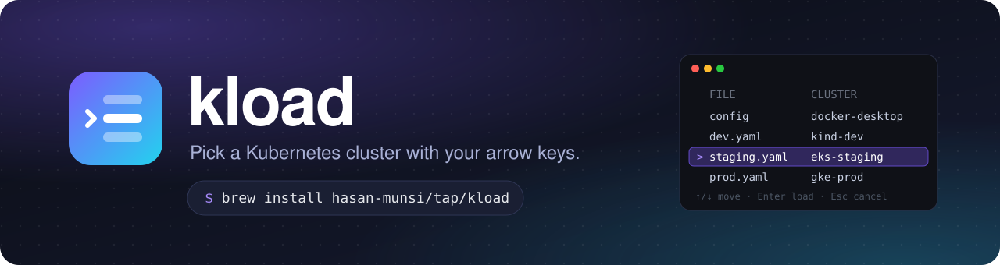

<p align="center">
  
</p>

<p align="center">
  <a href="https://github.com/hasan-munsi/kload/releases/latest"></a>
  <a href="https://github.com/hasan-munsi/kload/actions/workflows/test.yml"></a>
  
  
  <a href="LICENSE"></a>
</p>

<p align="center">
  
</p>

**kload** puts every cluster you have a kubeconfig for into one menu. Move with the arrow keys, press Enter, and `kubectl`, `helm` and `k9s` are on that cluster in every terminal. Each row shows the kubeconfig file first, then the cluster in it, so you pick by the name you gave the file: `dev.yaml`, `staging.yaml`, `prod.yaml`.

- **One command, no setup per cluster.** Drop a kubeconfig file into `~/.kube` and it is in the menu.
- **Every cluster at once.** kload adds all your kubeconfig files to `KUBECONFIG`, so any tool that names a context finds it.
- **Safe by default.** Production clusters get a red warning, and one broken kubeconfig file is skipped instead of breaking `kubectl`.
- **Nothing to run in the background.** kload is a small zsh function over `kubectl config`; nothing leaves your machine.

## Install

```bash
brew install hasan-munsi/tap/kload
echo 'source "$(brew --prefix)/share/kload/kload.zsh"' >> ~/.zshrc
exec zsh
```

kload needs that `source` line because it sets `KUBECONFIG` in your shell, which a separate program cannot do. Homebrew also installs `kubectl` (`kubernetes-cli`) if you don't have it.

<details>
<summary>Without Homebrew</summary>

```bash
git clone https://github.com/hasan-munsi/kload.git ~/.kload
echo 'source ~/.kload/kload.zsh' >> ~/.zshrc
exec zsh
```

Update with `git -C ~/.kload pull`.
</details>

## Use

| Command | What it does |
|---|---|
| `kload` | Opens the menu, starting on the current cluster |
| `kload <text>` | Loads the cluster whose file, cluster or context name contains `<text>`: `kload staging`, `kload prod` |
| `kload -` | Goes back to the cluster this shell used before |
| `kload -l` | Lists the clusters without switching |
| `kload -h` | Help; `kload -v` prints the version |

In the menu:

| Key | Action |
|---|---|
| <kbd>↑</kbd> <kbd>↓</kbd> (or <kbd>k</kbd> <kbd>j</kbd>) | Move |
| <kbd>Home</kbd> <kbd>End</kbd> (or <kbd>g</kbd> <kbd>G</kbd>) | First, last |
| <kbd>Enter</kbd> | Load the highlighted cluster |
| <kbd>Esc</kbd>, <kbd>q</kbd> or <kbd>Ctrl</kbd>+<kbd>C</kbd> | Cancel |

`kload <text>` changes nothing when the text matches more than one cluster; it lists the matches instead. <kbd>Tab</kbd> completes context names when zsh completion is on.

## Add a cluster

Save the kubeconfig your provider gives you (EKS, GKE, AKS, Linode, DigitalOcean, kind, …) into `~/.kube`, named after the environment:

```bash
mv ~/Downloads/kubeconfig.yaml ~/.kube/staging.yaml
kload staging
```

The file name is what you see in the menu, so `staging.yaml` reads better than `kubeconfig (3).yaml`.

## How it works

- **Which files.** `KUBECONFIG` becomes `~/.kube/config`, then any files that were already in your `KUBECONFIG`, then every `*.yaml` and `*.yml` file in `~/.kube` that contains contexts. Other YAML files in the folder are ignored.
- **Where the switch is saved.** kload runs `kubectl config use-context`, which saves the current context in the first file, normally `~/.kube/config`. A switch therefore applies to every terminal, as it does with plain `kubectl`.
- **Broken files.** If `kubectl` cannot read a file, kload says so and leaves it out of `KUBECONFIG`, because a single unreadable file makes every `kubectl` command fail.
- **Duplicate names.** When two files define the same context name, `kubectl` uses the first one. The menu shows both rows and kload tells you which file `kubectl` reads.
- **Two contexts for one cluster** in the same file (for example admin and read-only) would look identical, so the menu then adds a context column.

## Settings

Set these in `~/.zshrc` **before** the `source` line.

| Variable | Default | Meaning |
|---|---|---|
| `KLOAD_DIR` | `~/.kube` | Folder that holds your kubeconfig files |
| `KLOAD_PROD_MATCH` | `prod` | Text in a file, cluster or context name that marks production (red warning). Empty turns the warning off |

## Update and uninstall

```bash
brew upgrade kload
brew uninstall kload    # then remove the source line from ~/.zshrc
```

## Development

```bash
zsh tests/run.zsh       # needs kubectl, no cluster: the tests use throwaway kubeconfig files
```

To release a version, set `KLOAD_VERSION` in `kload.zsh`, commit, and run `scripts/release.sh <version>`. It tags the commit, publishes a GitHub release, and points the formula in [hasan-munsi/homebrew-tap](https://github.com/hasan-munsi/homebrew-tap) at it, so `brew upgrade kload` picks it up.

## License

[MIT](LICENSE)
